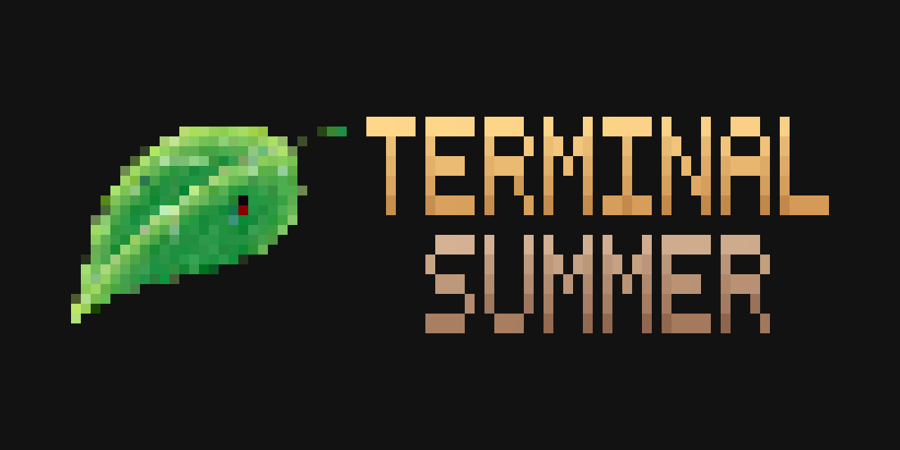

# Terminal-Summer

<p align="center">
  
</p>

Перенос легендарной визуальной новеллы ["Бесконечное лето"](https://store.steampowered.com/app/331470/Beskonechnoe_Leto/) в консольное окружение.  
Все сцены, спрайты и задники преобразуются в ANSI/ASCII-арты, а сам проект сделан на Python-фреймворке [textual](https://textual.textualize.io/).

Скриншоты:
|Everlasting Summer |Terminal Summer (ANSI) |Terminal Summer (цветной ASCII) |
|:---:              |:---:                  |:---:                   |
||||
||||
||||
||||
||||
||||


## Содержание
- [Технологии](#технологии)
- [Требования](#требования)
- [Использование](#использование)
  - [Запуск из исходников](#запуск-из-исходников)
  - [Сборка](#сборка)
- [FAQ](#faq)


## Технологии
- [Python 3.10+](https://www.python.org/)
- [Textual](https://textual.textualize.io/) - фреймворк для построения Rich TUI.
- [Pillow](https://pypi.org/project/pillow/) - обработка изображений и спрайтов.
- [pil2ansi](https://github.com/lostways/pil2ansi) - конвертация PNG в ANSI/ASCII-арт.
- [pygame-ce](https://pyga.me/) - аудио без графического окна (SDL_mixer).

## Требования
- Терминал с поддержкой **True Color** (Windows Terminal, kitty или другие).
- Подключение к интернету для автоматической загрузки отсутствующих ассетов. Архив занимает около **662 МБ**; для распаковки потребуется дополнительное место.
- Право записи в каталог проекта при запуске из исходников или в папку с готовым бинарником.

Для запуска из исходников и сборки дополнительно нужны:
- **Python** версии 3.10 или выше.
- **Git** для клонирования репозитория.

Для готового бинарника Python, Git и установка зависимостей через pip не нужны.

## Использование
Скачайте архив для своей ОС со [страницы последнего релиза](https://github.com/dydojopka/Terminal-Summer/releases/latest), разархивируйте и запустите из папки с бинарником:

Linux (проверено на Arch):
```bash
./terminal-summer
```

Windows (cmd.exe):
```bat
Terminal-Summer-Windows.exe
```

При отсутствии необходимых ресурсов приложение автоматически скачает и распакует архив ассетов в папку рядом с бинарником.


Вместо готового бинарника можно запустить игру из исходников или собрать её самостоятельно.

### Запуск из исходников
Для запуска без сборки достаточно зависимостей из `requirements.txt`. PyInstaller и инструменты разработки не нужны.

#### Linux:
```bash
git clone https://github.com/dydojopka/Terminal-Summer.git
cd Terminal-Summer
python3 -m venv .venv
source .venv/bin/activate
python3 -m pip install -r requirements.txt
python3 src/main.py
```

#### Windows (cmd.exe):
```bat
git clone https://github.com/dydojopka/Terminal-Summer.git
cd Terminal-Summer
python -m venv .venv
.venv\Scripts\activate.bat
python -m pip install -r requirements.txt
python src\main.py
```

При отсутствии необходимых ресурсов приложение автоматически скачает и распакует архив ассетов в папку `TS` в корне проекта. При повторном запуске достаточно активировать созданное окружение и выполнить команду запуска из корня проекта.

### Сборка
`requirements.txt` содержит зависимости для запуска игры из исходников. Для сборки используйте `requirements-dev.txt`: он уже включает `requirements.txt`, а также PyInstaller и инструменты разработки Textual. Устанавливать оба файла отдельно не нужно.

Скрипты сборки автоматически подготавливают ассеты и проверяют их перед сборкой. Они создают бинарник в корне проекта, но не запускают игру.

#### Linux:
1. Клонирование репозитория:
```bash
git clone https://github.com/dydojopka/Terminal-Summer.git
cd Terminal-Summer
```

2. Установка зависимостей:
```bash
python3 -m venv .venv
source .venv/bin/activate
python3 -m pip install -r requirements-dev.txt
```

3. Сборка:
```bash
bash scripts/build_and_run.sh
```

4. Запуск:
```bash
./terminal-summer
```


#### Windows (cmd.exe):
1. Клонирование репозитория:
```bat
git clone https://github.com/dydojopka/Terminal-Summer.git
cd Terminal-Summer
```

2. Установка зависимостей:
```bat
python -m venv .venv
.venv\Scripts\activate.bat
python -m pip install -r requirements-dev.txt
```

3. Сборка:
```bat
scripts\build_and_run.bat
```

4. Запуск:
```bat
Terminal-Summer-Windows.exe
```

> [!TIP]
> Если ANSI/ASCII-арт обрезается, даже если он должен полностью помещаться на экране - 
> закройте программу, откройте окно консоли во весь экран и после этого запустите программу снова.


## FAQ

### Зачем это вообще нужно?

Чтобы было.
